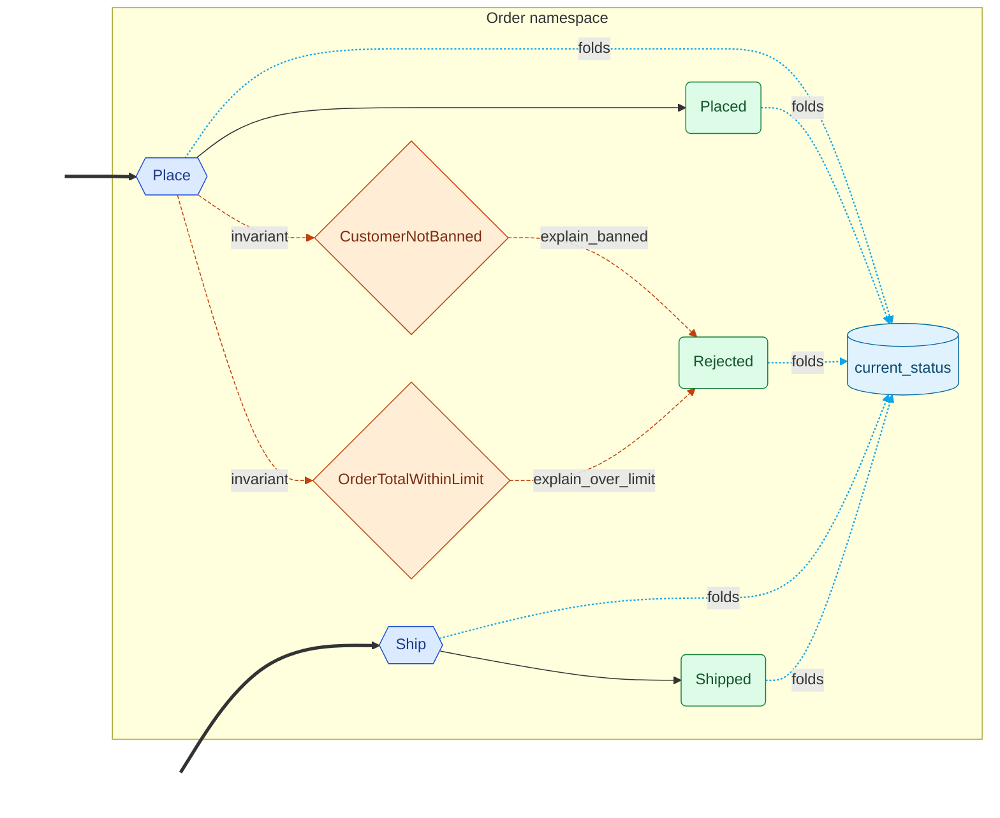

# langgraph-events

Opinionated event-driven abstraction for LangGraph with a **DDD-aligned event taxonomy**. State IS events.

!!! warning "Experimental (v0.47.2)"
    This is an early-stage personal project, not a supported product. The API will change without notice or migration path. Do not depend on this for anything that you cannot rewrite with little effort.

Model your domain as namespaces with commands and outcomes, colocate the handler on the command, and let `EventGraph` derive the topology. The quick start is in the [README](https://github.com/cadance-io/langgraph-events#quick-start). The install lines are in [Getting Started](getting-started.md#install).

## What the graph looks like

`graph.namespaces().mermaid()` on the [`order`](patterns.md#order) example:

<!-- autogen:start:hero -->

<!-- autogen:end -->

## Navigate

- [Getting Started](getting-started.md)
- [Concepts](concepts.md)
- [Control Flow](control-flow.md) — fan-out, paused threads, exceptions, retries, invariants
- [Reducers](reducers.md) — namespace-scoped or graph-wide
- [Patterns](patterns.md)
- [Streaming](streaming.md)
- [AG-UI Adapter](agui.md)
- [Reflection](reflection.md) — `graph.reflect(log)` and the `query_log` tool: an LLM queries the run's facts lazily instead of holding the log in context
- [Event Migrations](event-migrations.md) — keep old checkpoints working after a rename
- [Migration Gate and Deploys](migration-gate.md) — the release gate, the deploy steps and the store rewrite
- [Retiring an Interrupted Subclass](retiring-interrupted.md) — delete a pause class and keep each paused thread resumable
- [API Reference](api.md)
