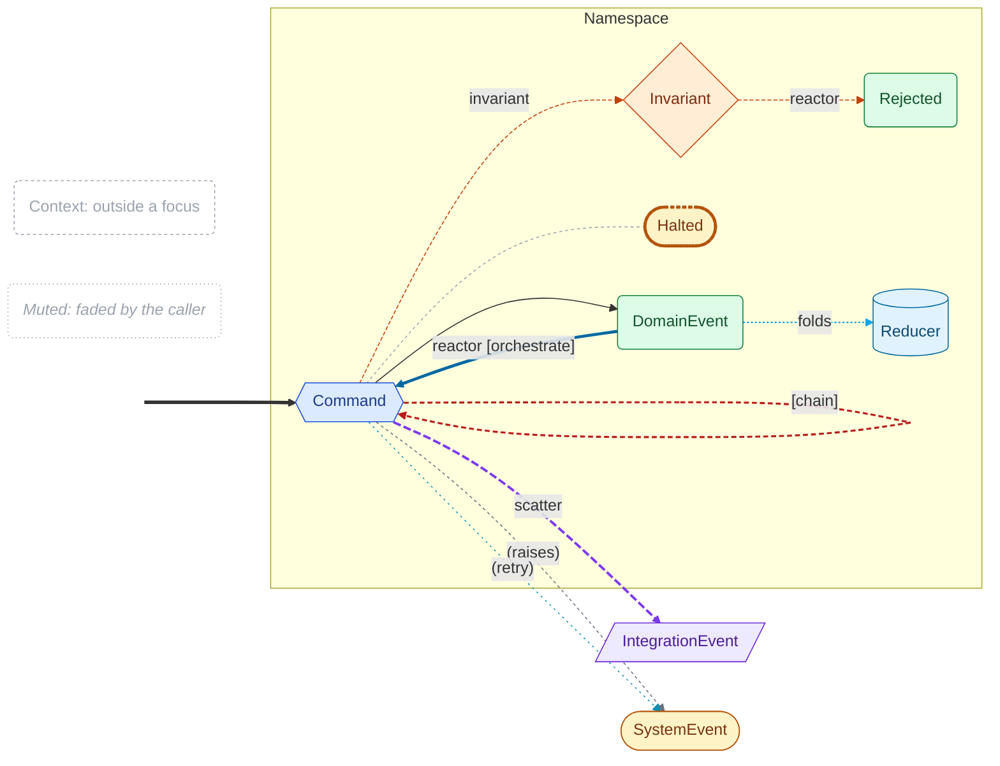
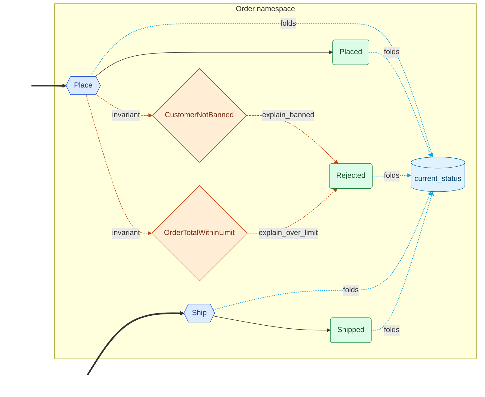
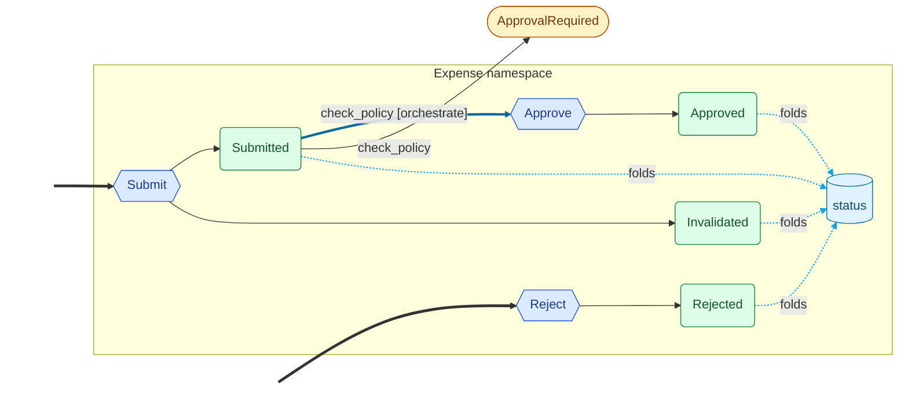
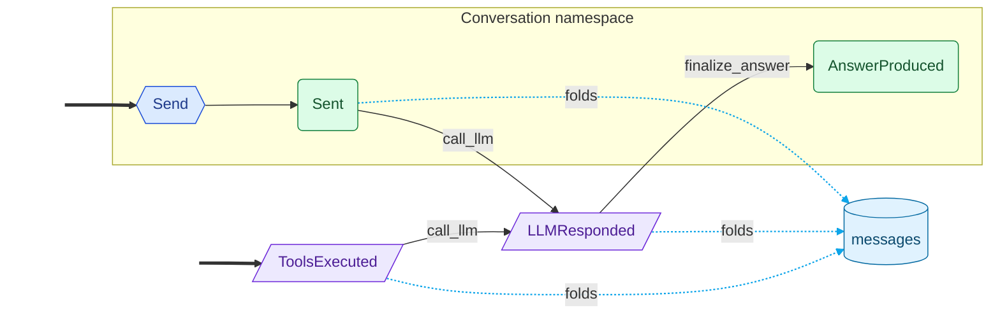
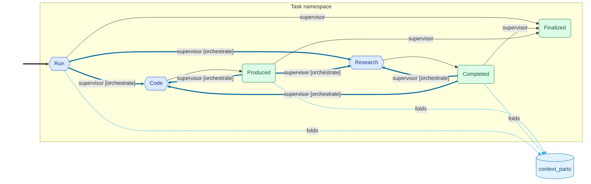
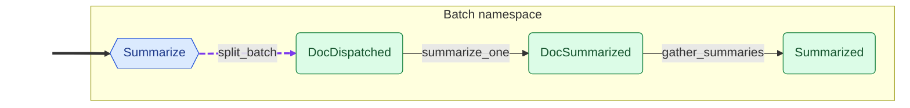
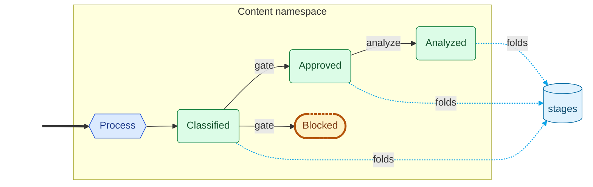
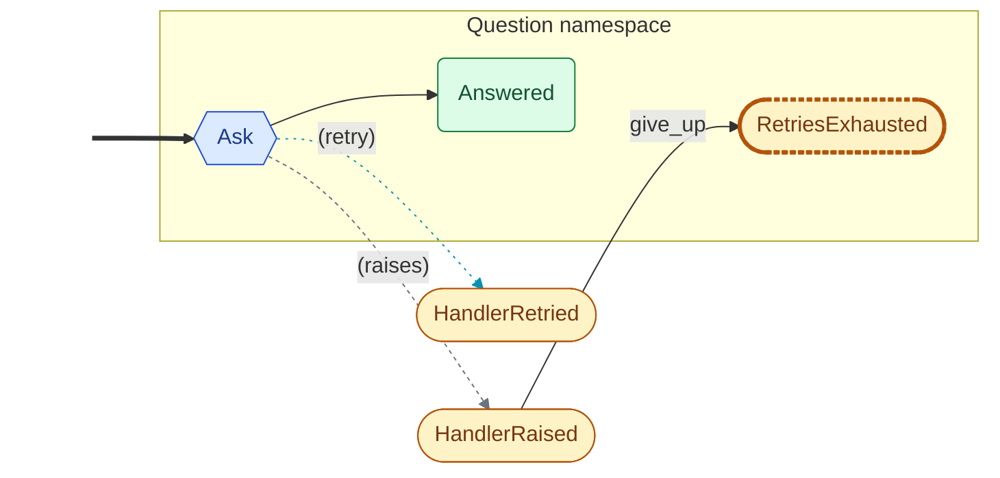

# Patterns

Runnable examples in `examples/`. Diagrams auto-generated from each example's `graph.namespaces()` (always in sync with code).

| If you need…                          | See                                       | Related docs                                                          |
| ------------------------------------- | ----------------------------------------- | --------------------------------------------------------------------- |
| Invariants + pinned handlers          | [Order](#order)                       | [control-flow](control-flow.md#invariants)                            |
| Approval on a paused thread           | [Expense](#expense-hitl)                  | [control-flow](control-flow.md#interrupted-resumed)                   |
| Tool-calling agent + AG-UI streaming  | [Conversation](#conversation-agui)        | [agui](agui.md), [reducers](reducers.md#message_reducer)              |
| Supervisor loop / fan-in              | [Task](#supervisor)                       | [reducers](reducers.md#reducer)                                       |
| Scatter fan-out / map-reduce          | [Batch](#scatter-fan-out)                 | [control-flow](control-flow.md#scatter)                               |
| Safety gates + live streaming         | [Content](#content-pipeline)              | [streaming](streaming.md), [concepts](concepts.md#system-events)      |
| Retries + escalation via `retry=`     | [Question](#error-recovery)               | [control-flow](control-flow.md#retries)                               |
| Renamed event class, old checkpoints  | [event_migration.py](https://github.com/cadance-io/langgraph-events/blob/main/examples/event_migration.py) | [event-migrations](event-migrations.md) |
| Agent diagnoses a run with `query_log` | [reflection_agent.py](https://github.com/cadance-io/langgraph-events/blob/main/examples/reflection_agent.py) | [reflection](reflection.md) |

<!-- autogen:start:legend -->

🗝️ Diagram vocabulary

<!-- autogen:end -->

## Invariants & handlers (Order namespace) { #order }

- Commands: `Place`, `Ship`. Outcomes: `Placed`, `Rejected`, `Shipped`.
- Invariants: `CustomerNotBanned`, `OrderTotalWithinLimit`. Pinned handlers turn a violation into a namespace-level `Order.Rejected`.
- State: `current_status` (`ScalarReducer` as a namespace attribute).

<!-- autogen:start:order -->

[Full code](https://github.com/cadance-io/langgraph-events/blob/main/examples/order.py) · [Raw diagrams on GitHub](https://github.com/cadance-io/langgraph-events/blob/main/examples/order.graph.md)
<!-- autogen:end -->

The inline handler can carry any name, such as `place` or `ship`. See [inline command handlers](concepts.md#inline-command-handlers).

## Approval on a paused thread (Expense namespace) { #expense-hitl }

- An LLM extracts expense data. A policy handler auto-approves small expenses or pauses with [`Interrupted`](control-flow.md#interrupted-resumed) for manager review.
- Resume with an `Approve` or `Reject` command.

<!-- autogen:start:expense_approval -->

[Full code](https://github.com/cadance-io/langgraph-events/blob/main/examples/expense_approval.py) · [Raw diagrams on GitHub](https://github.com/cadance-io/langgraph-events/blob/main/examples/expense_approval.graph.md)
<!-- autogen:end -->

## Tool-calling + AG-UI (Conversation namespace) { #conversation-agui }

ReAct tool-calling agent with an `AGUIAdapter` built for **AG-UI frontend tools** (CopilotKit `useFrontendTool`). `main()` runs the graph directly with `graph.ainvoke` and no frontend tool registered. It does not drive `adapter.stream`.

- Frontend-declared tools bound to the LLM via `build_langchain_tools`.
- Tool calls stream as `ToolCallStart`/`ToolCallArgs`/`ToolCallEnd`. Results return via `detect_new_tool_results` → `ToolsExecuted`.
- `DomainEvent + MessageEvent` mixin with [`message_reducer()`](reducers.md#message_reducer).
- For the handler-initiated `FrontendToolCallRequested` pattern, see [AG-UI](agui.md#handler-initiated-frontend-tools).

<!-- autogen:start:conversation -->

[Full code](https://github.com/cadance-io/langgraph-events/blob/main/examples/conversation.py) · [Raw diagrams on GitHub](https://github.com/cadance-io/langgraph-events/blob/main/examples/conversation.graph.md)
<!-- autogen:end -->

## Supervisor fan-in (Task namespace) { #supervisor }

- `Task.Run` starts the supervisor loop. The supervisor dispatches sub-commands `Task.Research` / `Task.Code` or emits the terminal `Task.Finalized` fact.
- A custom [`Reducer`](reducers.md#reducer) projects specialist outputs into shared context.

<!-- autogen:start:supervisor -->

[Full code](https://github.com/cadance-io/langgraph-events/blob/main/examples/supervisor.py) · [Raw diagrams on GitHub](https://github.com/cadance-io/langgraph-events/blob/main/examples/supervisor.graph.md)
<!-- autogen:end -->

## Scatter fan-out (Batch namespace) { #scatter-fan-out }

- `Batch.Summarize` fans out to per-document work via [`Scatter[DocDispatched]`](control-flow.md#scatter).
- Gather handler uses `EventLog.filter()` to wait for all `DocSummarized` facts, then emits `Batch.Summarized`.

<!-- autogen:start:map_reduce -->

[Full code](https://github.com/cadance-io/langgraph-events/blob/main/examples/map_reduce.py) · [Raw diagrams on GitHub](https://github.com/cadance-io/langgraph-events/blob/main/examples/map_reduce.graph.md)
<!-- autogen:end -->

## Safety gates + streaming (Content namespace) { #content-pipeline }

- Inline `Content.Process.handle` classifies text (keyword-based, no LLM).
- External handlers gate approval, emitting `Content.Blocked` ([`Halted`](concepts.md#system-events) subtype) or `Content.Approved`.
- Live streaming via `astream_events()`.

<!-- autogen:start:content_pipeline -->

[Full code](https://github.com/cadance-io/langgraph-events/blob/main/examples/content_pipeline.py) · [Raw diagrams on GitHub](https://github.com/cadance-io/langgraph-events/blob/main/examples/content_pipeline.graph.md)
<!-- autogen:end -->

## Retries & escalation (Question namespace) { #error-recovery }

- `Ask` declares `raises=` and `retry=RetryPolicy(max_attempts=3)`. Retries emit `HandlerRetried`. The third failure emits `HandlerRaised`, which `give_up` turns into `Question.RetriesExhausted` (`Halted`). See [retries](control-flow.md#retries).

<!-- autogen:start:error_recovery -->

[Full code](https://github.com/cadance-io/langgraph-events/blob/main/examples/error_recovery.py) · [Raw diagrams on GitHub](https://github.com/cadance-io/langgraph-events/blob/main/examples/error_recovery.graph.md)
<!-- autogen:end -->

